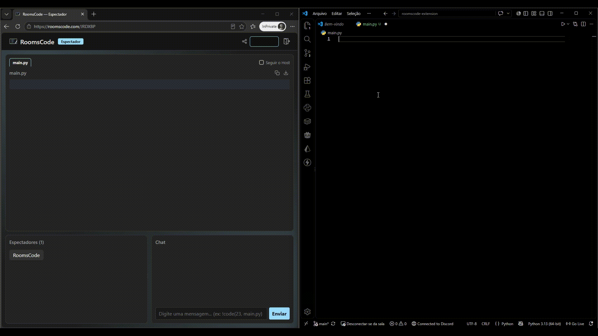
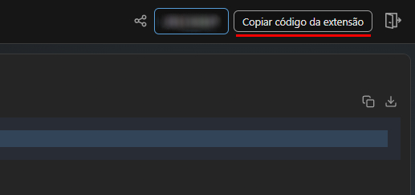
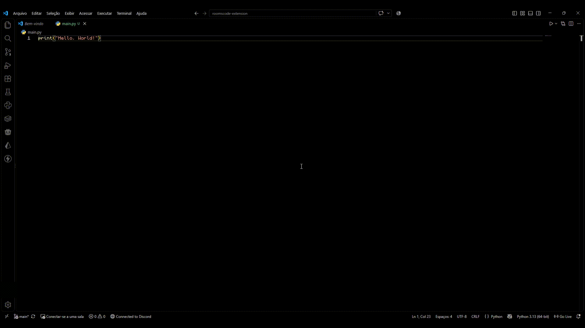
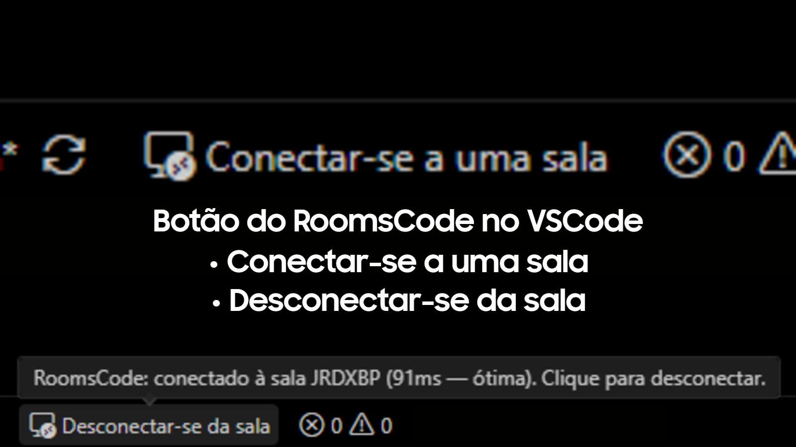

# RoomsCode para VS Code

Transmita ao vivo o código que você edita no VS Code para os espectadores de uma sala do [RoomsCode](https://roomscode.com). Eles acompanham pelo navegador, com destaque de sintaxe, e **não precisam instalar nada**.

## O que ela faz

- Sincroniza **todas** as abas abertas, na mesma ordem do VS Code (inclusive quando você reordena).
- Atualiza em tempo real enquanto você digita, enviando só o que mudou.
- Envia a linha do seu cursor, para os espectadores acompanharem onde você está.
- Compartilha apenas arquivos da pasta (workspace) aberta.

> A extensão não compartilha a tela. Isso é feito pelo navegador, na página do Host.

## Como usar

1. Instale a extensão pela aba **Extensões** do VS Code (busque por "RoomsCode").
2. Crie uma sala em [roomscode.com](https://roomscode.com) como **Host**.
3. Na tela do Host, clique em **Copiar código da extensão**. Ele é diferente do código da sala que os espectadores usam.

   

4. No VS Code, clique em **Conectar-se a uma sala**, na barra de status (canto inferior esquerdo), ou use `Ctrl+Shift+P` / `Cmd+Shift+P` e busque por "RoomsCode: Conectar a uma sala". Cole o código.

   

5. Pronto: uma notificação confirma a conexão e suas abas passam a ser transmitidas.
6. Para encerrar, clique em **Desconectar-se da sala**, na barra de status.

Se a conexão cair, a extensão reconecta sozinha, sem pedir o código de novo. Com a conexão ativa, passe o mouse sobre o botão da barra de status para ver a latência com o servidor.

## Comandos

| Comando | O que faz |
|---|---|
| `RoomsCode: Conectar a uma sala` | Conecta o VS Code à sala, usando o código da extensão. |
| `RoomsCode: Desconectar da sala` | Encerra a transmissão. A sala continua até o Host encerrá-la no navegador. |
| `RoomsCode: Conectar a um servidor personalizado (avançado/desenvolvimento)` | Usa outro servidor no lugar de `https://roomscode.com`. |

## Requisitos

- VS Code 1.85 ou superior.
- Uma sala criada na página do Host.

## Privacidade e segurança

- Só o que está aberto no editor é transmitido, e apenas arquivos dentro do workspace atual. Nada é lido do disco além disso.
- O código da extensão autentica a conexão e já identifica a sala. Sem ele, o servidor recusa qualquer envio de conteúdo.
- Fechar o VS Code ou desconectar encerra a transmissão na hora.

## Feedback

Encontrou um problema ou tem uma sugestão? Abra uma [issue no GitHub](https://github.com/rdurooon/roomscode-extension/issues). Licença [MIT](LICENSE).
